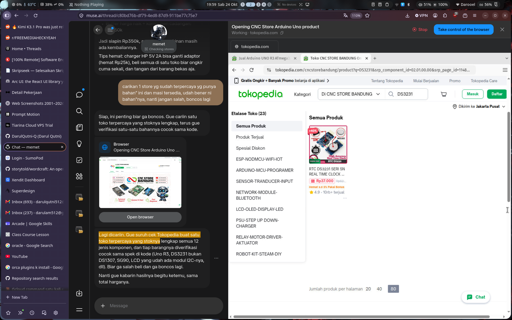

# Ignix V2 Linux

Desktop configuration tool for the **Vortex Ignix V2** (Xenta IGNIX F5V2, USB `1d57:22ae`) gaming mouse on Linux. The official software is Windows-only, so this is a clean-room reverse-engineered replacement.



## Features

- **DPI stages** — up to 6 levels, 50–30000 DPI, per-stage color indicators
- **Polling rate** — 125 / 250 / 500 / 1000 Hz
- **Lighting** — 7 effects (static, breathing, rainbow, marquee, flow, etc.), RGB picker, brightness & speed
- **Button remap** — click any button on the mouse image to reassign it (mouse, DPI, media, keyboard, macro)
- **Macros** — record and upload macros (auto-clicker friendly)
- **5 hardware profiles** stored on the mouse

## Install

One line, no Rust toolchain needed:

```bash
curl -fsSL https://raw.githubusercontent.com/DarulQutni-Q/ignix-v2-linux/main/install.sh | bash
```

This downloads the prebuilt binary, installs the udev rule (so no `sudo` needed to talk to the mouse), and adds a desktop entry.

### Manual

Download the latest `ignix-gui` binary from [Releases](../../releases), then:

```bash
sudo cp 99-ignix-v2.rules /etc/udev/rules.d/
sudo udevadm control --reload-rules && sudo udevadm trigger
./ignix-gui
```

### Build from source

```bash
cargo build --release
./target/release/ignix-gui
```

Requires Rust 1.70+. Dependencies are fetched automatically.

## Usage

Plug in the mouse (USB cable or 2.4GHz dongle), launch the app, and it will auto-detect the device. Changes are written straight to the mouse hardware — no daemon, no background service.

> **Note:** Battery level is only reported by the official app in wireless mode and is not exposed over the wired HID config interface, so this tool does not show it.

## Protocol

The USB HID protocol was reverse-engineered from the official Windows app. Full documentation: [`PROTOCOL.md`](PROTOCOL.md).

## License

MIT — do whatever you want with it.
